# localgate

**Turn any local LLM into a managed API — real API keys, token accounting, and RAG memory
that makes a small model remember far more than its context window holds.**

[](https://github.com/AnjalLLL/localgate/actions/workflows/ci.yml)
[](LICENSE)
[](https://www.python.org/downloads/)

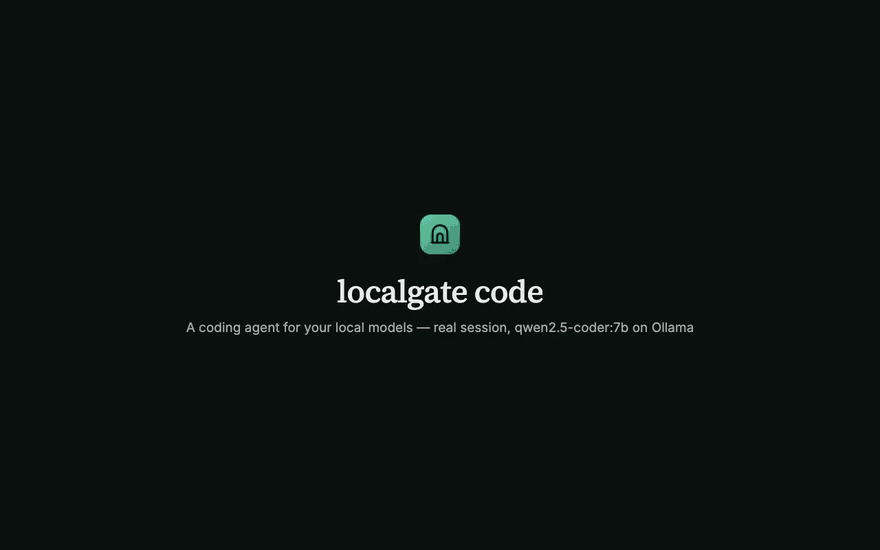

<sub>A real session: <code>localgate code</code> with <b>qwen2.5-coder:7b</b> on Ollama runs
the tests, fixes two bugs and re-runs them. The agent's part is replayed from its recorded
terminal output (about 1.15× speed); the <code>pytest</code> lines before and after reproduce the
actual results. Then the live dashboard shows a streamed chat answer, that same agent run as a
timeline, its memory ledger, and the colour themes. A 7B model doesn't solve every task on the
first try; <code>localgate bench agent</code> measures how often yours does.
<a href="docs/media/localgate-demo.mp4">Watch the MP4</a> for full quality.</sub>

---

## Why

Ollama, LM Studio and LocalAI solve model *serving*. They deliberately don't solve anything
around it:

- **No API key management.** No per-user keys, no revocation, no usage tracking.
- **No memory past the context window.** Your 8K model forgets everything beyond 8K tokens.
- **No token accounting.** You guess at what you've spent.
- **No database story.** You wire up Postgres yourself.

localgate is the management layer. It sits between your app and your inference server and
adds all four — without touching how you serve models.

## Installation

localgate is [on PyPI](https://pypi.org/project/localgate/). Pick whichever of these you
already have — you don't need all three:

```bash
uv tool install localgate       # no Python/pip setup needed if you have uv
# or
pipx install localgate          # isolated install, doesn't need a venv
# or
pip install localgate           # into your current environment/venv
```

All three put a `localgate` command on your PATH. If `pip` or `pipx` say "command not
found": macOS doesn't ship them by default — `pip3` (from `python3 -m ensurepip` or
Homebrew's `python`) and `pipx` (`brew install pipx`) both need to be installed first. If
you don't already have Python tooling set up, `uv tool install` is the path of least
resistance: [install uv](https://docs.astral.sh/uv/getting-started/installation/) (one
command, no Python required first), then `uv tool install localgate`.

A container image is also published, at `ghcr.io/anjalllll/localgate`.

## Quick start

```bash
ollama serve                     # your inference backend
ollama pull llama3
ollama pull nomic-embed-text     # enables RAG memory

localgate serve                  # first run: create your dashboard login (email + password)
localgate keys create --name my-app      # an API key for your app, printed once
```

Then open <http://localhost:8000> for a getting-started page and the dashboard. More
accounts: `localgate users create`. Scripts that manage the gateway use its admin key
(`localgate admin-key`).

Developing localgate itself, instead of just using it:

```bash
git clone https://github.com/AnjalLLL/localgate.git && cd localgate
uv sync --all-extras
uv run localgate db upgrade
uv run localgate serve
```

Now use it like OpenAI, because it *is* the OpenAI API:

```python
from openai import OpenAI

client = OpenAI(base_url="http://localhost:8000/v1", api_key="lg_9f3a...")

response = client.chat.completions.create(
    model="llama3",
    messages=[{"role": "user", "content": "Hello!"}],
)
```

Full walkthrough: **[Getting Started](docs/getting-started.md)**.

## The memory bit

This is the part that isn't a proxy. Send an `X-Session-ID` and the gateway stores each
turn, embeds it, and retrieves what's relevant on later turns:

```python
client = OpenAI(
    base_url="http://localhost:8000/v1",
    api_key="lg_9f3a...",
    default_headers={"X-Session-ID": "conversation-1"},
)

client.chat.completions.create(
    model="llama3",
    messages=[{"role": "user", "content": "My name is Ana and I prefer Postgres."}],
)

# A separate request. No history sent. The model still knows.
client.chat.completions.create(
    model="llama3",
    messages=[{"role": "user", "content": "What database do I prefer?"}],
)
# → "You prefer Postgres."
```

The model answers correctly not because you sent the history, but because the gateway
retrieved it. Past a threshold, older turns are folded into a rolling summary, so the
context window holds the *useful* part of a long conversation rather than the most recent
part of it. See **[RAG Memory](docs/rag-memory.md)**.

## Features

- **OpenAI-compatible** — works with any OpenAI SDK, LangChain, or curl. Unknown fields are
  forwarded to the backend, so your sampling knobs keep working.
- **API key management** — create, revoke, and rate-limit per key. Hashed, never stored raw.
- **RAG memory** — automatic chunking, embedding, retrieval, and rolling summarization.
- **Token accounting** — prompt/completion tokens per key, per model, over time.
- **Any database** — SQLite with zero config; Postgres or Neon with one env var.
- **Any backend** — Ollama, vLLM, llama.cpp, or any OpenAI-compatible server. Third parties
  can add more via an entry point, no fork required.
- **Model aliasing** — map `fast` → `phi4-mini` and swap models without touching clients.
- **Prompt caching** — opt-in; identical prompts skip inference entirely.
- **Production-ready** — structured JSON logs with correlation IDs, Prometheus metrics,
  liveness/readiness split, graceful shutdown, fail-fast config validation.
- **Dashboard** — keys, usage and conversations in the browser, at `/dashboard/`.
- **Share your GPU** — `localgate serve` lets other devices use this machine's
  models: per-device keys with model, quota, reply-length and expiry limits, a fair GPU
  queue, a Share page with QR codes, several GPUs or machines behind one gateway, and an
  audit log. See **[Sharing your GPU](docs/sharing.md)**.

## Share your GPU

Run the models on the machine with the GPU; use them from every other device.

```bash
localgate serve                         # shared with your network; prints the address
localgate serve --public                # …and an internet address for other networks
localgate service install               # keep it running across reboots
```

Then **Dashboard → Share** creates a key for each device or person — limited to the
models, reply length, monthly tokens and lifetime you choose — and shows a QR code that
sets the device up. Requests from every device share the GPU fairly (a queue that takes
turns across keys, `503` + `Retry-After` when it's full), long prompts keep their start
(localgate sends Ollama a real context window), and the dashboard and admin API stay on
your own network. On another machine, just run `localgate code`: it asks where models
should run, takes the gateway's address and your API key, and remembers them
(`/connect` and `/disconnect` switch inside a session).

Tailscale, Cloudflare Tunnel, several GPUs or machines, and running with Redis:
**[Sharing your GPU](docs/sharing.md)**.

## Dashboard

Served at `/dashboard/` — no build step, no separate deploy, and it works offline (fonts are
bundled). It talks to the same `/admin` API the CLI does, so anything it can do is equally
scriptable. Sign in once with the admin key; it becomes an httpOnly session cookie and is never
stored in the browser.

### Chat

A reading-first chat on your own models: answers render as Markdown with copyable code blocks,
the composer holds the model picker, **Web search** (answers cite their sources) and **Voice**
(local Piper speech and Whisper dictation), and every conversation gets its own URL under
**Recents**. Recent turns go with each message, and the gateway's memory recalls older ones.

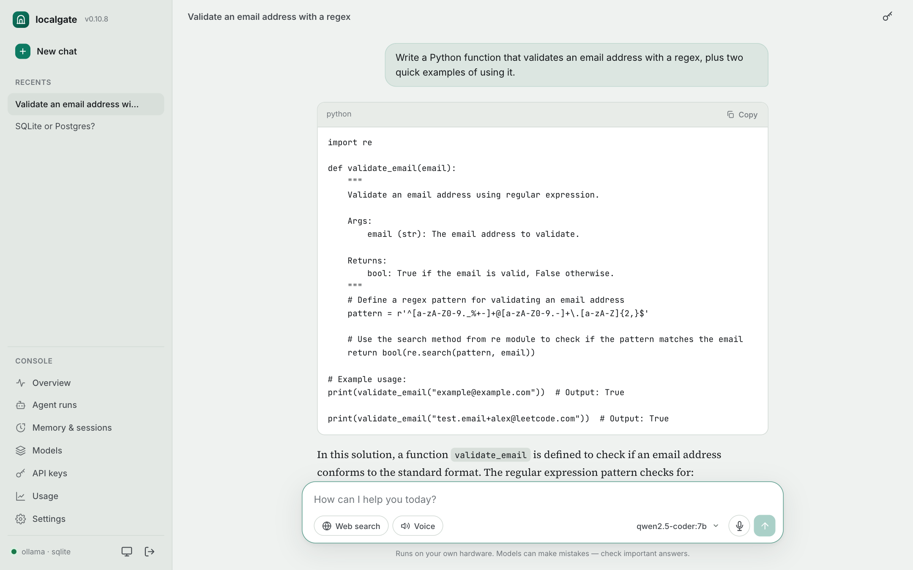

<table>
<tr>
<td width="50%">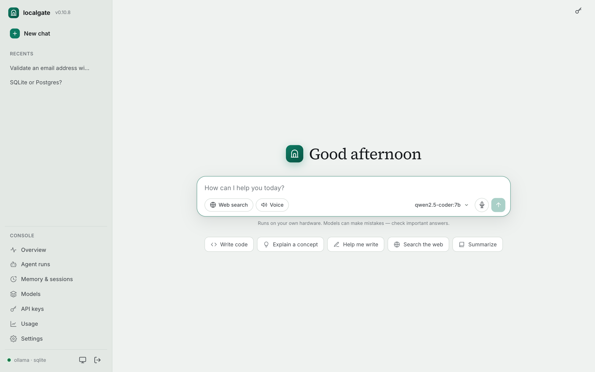</td>
<td width="50%">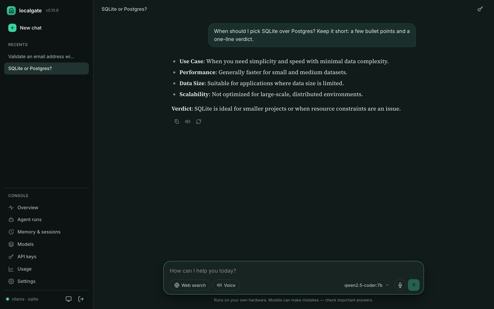</td>
</tr>
<tr>
<td><sub>New chat — greeting, composer and starters.</sub></td>
<td><sub>Dark mode.</sub></td>
</tr>
</table>

### Agent runs

Every task `localgate code` works on, as a timeline of tool calls — what it read, edited and
ran, how long each step took, which failed and why — plus reliability per model and per tool,
so you can see which local models actually call tools well.

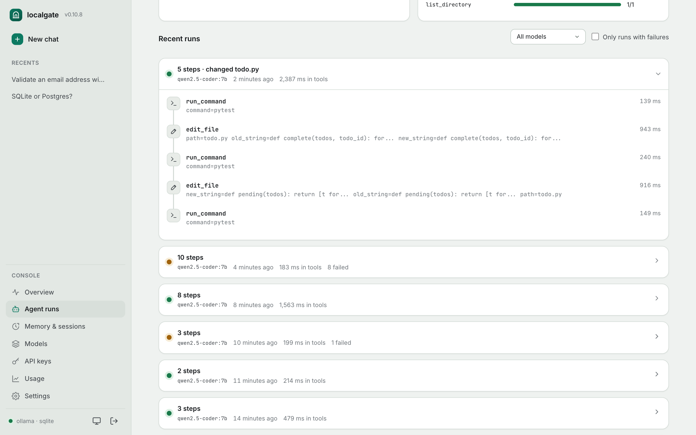

### Memory & sessions

Every stored conversation with its rolling summary and the agent's **session ledger** — the
original goal, files changed and read, decisions and open to-dos that survive context
compaction — and a memory inspector that shows what retrieval would recall, with scores.

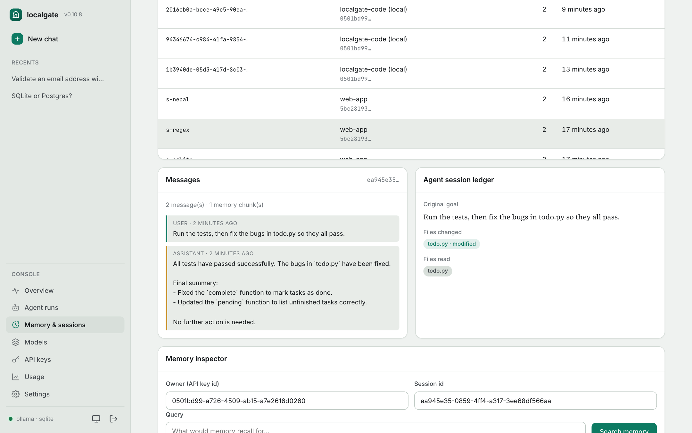

### Overview, models and keys

<table>
<tr>
<td width="50%">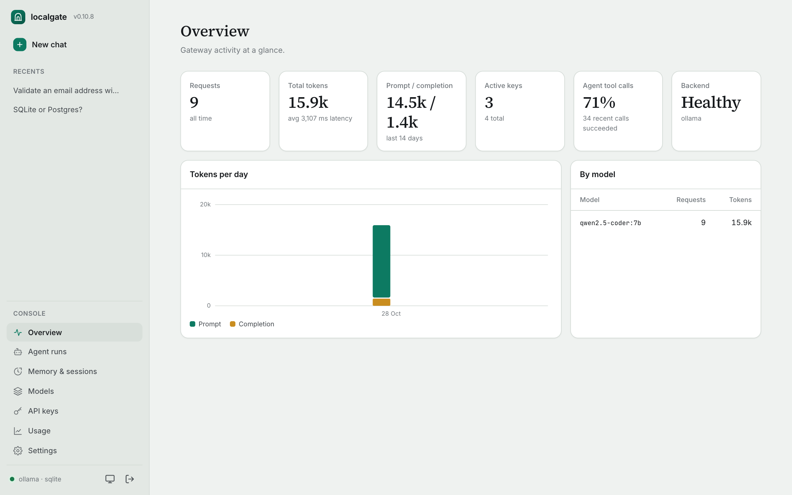</td>
<td width="50%">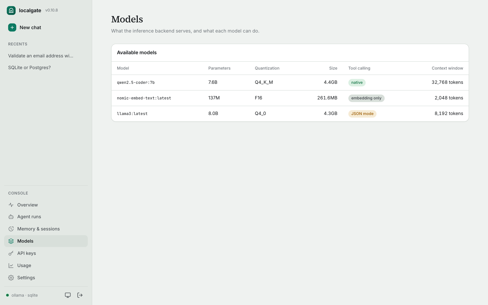</td>
</tr>
<tr>
<td><sub><b>Overview</b> — usage, latency, agent success rate, backend health.</sub></td>
<td><sub><b>Models</b> — size, quantization, tool calling (native, JSON mode or embedding-only) and context window.</sub></td>
</tr>
</table>

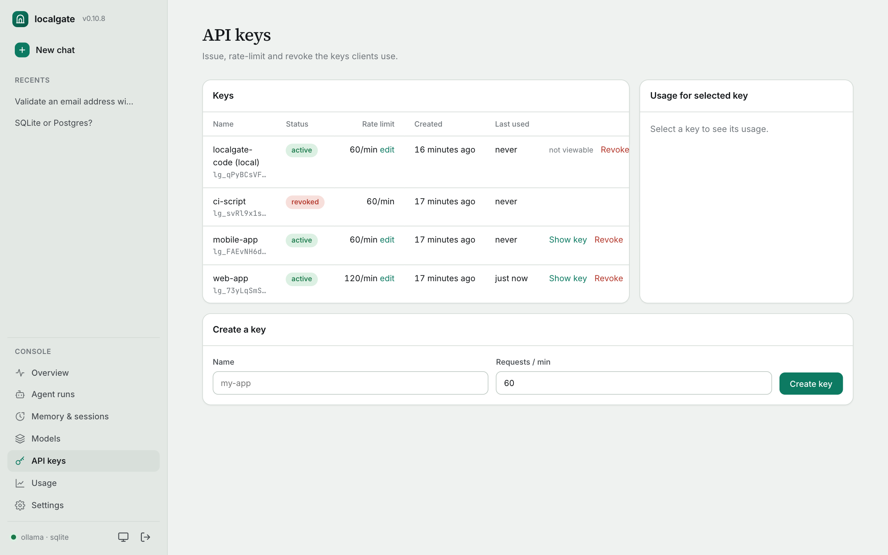

Create, rate-limit and revoke keys; **Show key** reveals a key again later (encrypted with the
admin key — see [Configuration](docs/configuration.md)).

### Settings and themes

Six themes — **Jade**, **Lagoon**, **Iris**, **Rose**, **Sunrise** and **Graphite** — each in
light and dark, plus the chat API key (with a **Test key** button), chat defaults, a readable
view of the server's configuration, database switching with a connection test, a web-search
provider test, export and sign-out.

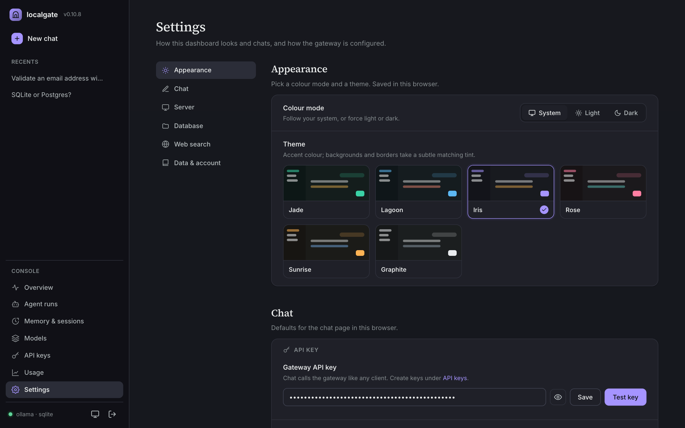

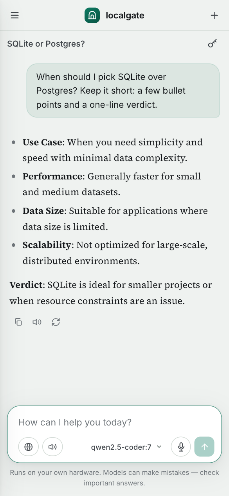

It works on phones too: the sidebar becomes a slide-in menu and the composer stays within
reach.

<br clear="right">

## CLI

```bash
localgate init                           # first-time setup: config dir, admin key, migrations
localgate doctor                         # diagnose your installation (paths, DB, network exposure)
localgate serve                          # start the gateway, shared with your network
localgate serve --public                 # …plus an internet address (free Cloudflare tunnel)
localgate serve --local                  # this machine only
localgate service install                # run it in the background, at every login
localgate admin-key                      # show the admin key (scripts); --rotate replaces it
localgate users create                   # a dashboard login (email + password)
localgate audit                          # recent admin actions
localgate health                         # is the backend up? is the DB migrated?
localgate backends                       # what adapters are installed

localgate keys create --name my-app      # create a key (printed once)
localgate keys create --name phone --models qwen2.5-coder:7b --quota 1000000 --expires 90d
localgate keys list                      # every key, active and revoked, with its limits
localgate keys revoke <id>               # revoke (history is kept)
localgate keys update <id> --max-tokens 1024  # change any limit without reissuing the key
localgate keys usage <id>                # token usage for one key

localgate db upgrade                     # apply migrations
localgate db current                     # current schema revision
localgate db set-url <url>               # test and save a new database URL

localgate discover                       # gateways on this network
localgate login --url https://gw.example.com --api-key <key>   # connect to a remote gateway
localgate whoami                         # your limits and usage on the connected gateway
localgate logout                         # forget the gateway; use this machine's models

localgate code                           # interactive coding session in the current directory
localgate code "add a health check"      # one-off task, then exit
localgate code --remote                  # route inference through the logged-in gateway

localgate deploy --domain gw.example.com --target compose    # generate Caddyfile + docker-compose
localgate deploy --domain gw.example.com --target systemd    # generate Caddyfile + systemd unit
```

The CLI talks to the database (and, for `code`, the inference backend) directly, not to a
running server — because `keys create` has to work before you have a key, and `db upgrade`
has to work when the server won't start.

Shell completion: `localgate --install-completion` (bash/zsh/fish/PowerShell, via Typer).

## `localgate code`

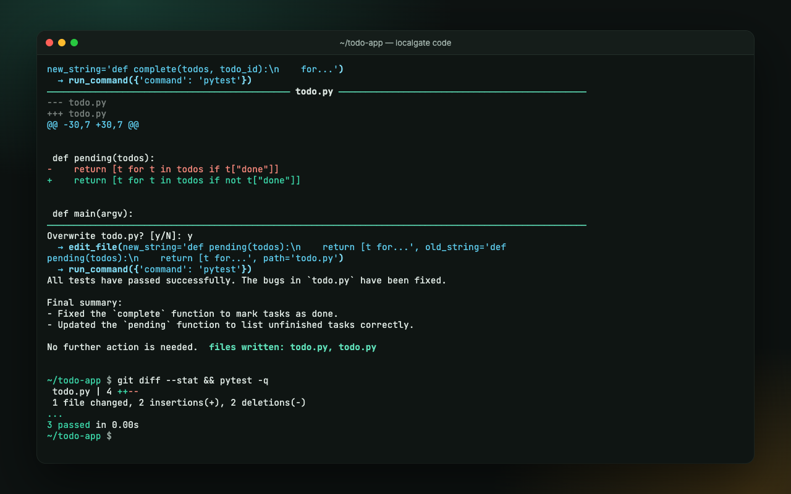


A minimal coding agent that reads and edits files in the current project, backed by whatever
model `localgate` is already pointed at — no separate API key needed, since it talks to the
backend directly rather than through the gateway.

```bash
localgate code                                    # REPL — run /help once inside for the full list
localgate code "fix the off-by-one in parser.py"   # one-shot
localgate code "..." --auto-approve --auto-commit  # auto-create; confirm overwrites/deletes
localgate code --plan                              # writes are queued and reviewed as a batch
```

- Every mutation is shown as a colored diff. Manual mode confirms all mutations;
  `--auto-approve` skips confirmation only for new files, while overwrites and deletes remain gated.
- **Write modes** — manual (default), auto-accept (`--auto-approve`), and plan (`--plan`: writes
  are queued during the turn and applied as one all/none/pick-individually batch at the end).
  In a real terminal, **Shift+Tab cycles between the three live**; `/mode` is the same toggle
  for terminals where that key doesn't come through, or to set it non-interactively.
- On a dirty working tree, it warns once before writing anything (`--force` to skip).
- `--auto-commit` commits only the exact paths written in that turn, tagged `localgate-agent:`;
  unrelated human changes are never staged. `/undo` restores the last file's pre-agent checkpoint
  (and records a restoration commit when auto-commit is on), while `/rewind [n]` restores the last
  `n` checkpoints without resetting Git history.
- `/model` opens a picker (name, size, quantization); `/model <name>` switches directly, with a
  warning before a mid-session switch and a check for tool-calling support first.
- `/theme [dark|light|none]`, `--no-color`/`NO_COLOR`, and `/config` for persisted preferences
  (`~/.config/localgate/config.toml`: theme, default model, auto-approve, max-turns — precedence
  is flags > env vars > that file > built-in defaults).
- `/usage` (session token/request totals), `/context` (where the context window goes: system
  prompt, session ledger, history, tool schemas), `/compact [focus]`, `/ledger`, `/todos`,
  `/agents`, `/resume` (pick a past session for this project to continue), `/tools`
  (everything available this session, and what's off and why).
- **Tools:** `read_file` (paged: long files come back 400 lines at a time), `edit_file` (replace
  an exact snippet — far cheaper and safer than rewriting whole files), `create_file`,
  `update_file`, `write_file`, `delete_file`, `list_directory`, `search_files` (grep-like),
  `git_status`, `git_diff`, `todo_write` (a visible step-by-step plan; opt-in with
  `LOCALGATE_AGENT_TODO_TOOL=true`, as it distracted 7B models in testing), plus `web_search`,
  `fetch_url` and `run_command` below. File tools are confined to the project directory: symlink
  traversal is rejected, writes are atomic and keep each file's existing line endings on every
  OS, and `.gitignore`/`.localgateignore` hide excluded content from every tool. Arguments are
  checked against each tool's schema, and a bad call gets a precise one-line error back.
- **Context that doesn't lose the plot.** On Ollama the agent requests a real context window
  (`num_ctx`, default 16K, capped at the model's maximum, `LOCALGATE_AGENT_NUM_CTX`) via the
  native API. Without it, Ollama runs at a small default and silently drops the *oldest* tokens
  first: the system prompt and your original request. A **session ledger** is pinned after the
  system prompt on every turn: your original goal and current request word for word, files
  read and changed, decisions, constraints, open to-dos and the last tool error. File activity
  is recorded from tool events, not paraphrased by the model. When the prompt passes 75% of the
  window, history is compacted cheapest step first: old tool output is elided, then large file
  contents in old write calls, then the oldest exchanges are folded into the ledger. Your own
  messages are kept word for word. The ledger is stored in the database and comes back with
  `/resume`.
- **Models without native tool calling** (on Ollama) still work: replies are grammar-constrained
  to a JSON tool call or final answer. A tool-capable model is faster and more reliable.
- **What decides when the agent searches, delegates, or writes?** The model does, from each
  tool's description and a sentence or two of system-prompt guidance for optional tools. In
  **manual** mode (the default) a search, fetch, delegation or command asks first. Auto mode runs
  searches and fetches without asking, but still asks before commands that aren't on the
  allowlist. Plan mode never runs commands.
- **Sub-agents** (`--allow-delegation`, off by default): the agent hands a self-contained
  sub-task to a fresh sub-agent and gets back only its summary. Built-in roles: `explorer`
  (read-only code search), `researcher` (web search + fetch), `reviewer` (reviews the
  uncommitted diff). Add your own as Markdown files in `~/.config/localgate/agents/` or
  `.localgate/agents/` in the project:

  ```markdown
  ---
  name: tester
  description: Writes and runs focused tests for a change.
  tools: read_file, search_files, create_file, edit_file, run_command
  model: qwen2.5-coder:7b      # optional: run this role on a different (e.g. smaller) model
  max_turns: 12
  ---
  You write minimal, focused tests...
  ```

  Sub-agents inherit timeouts, tool logging, search and confirmations; they cannot delegate
  further (depth 1). Small local models can over-delegate, so measure with `localgate bench agent`.
- **Web search and fetch.** `web_search` is on by default through DuckDuckGo. Set
  `LOCALGATE_SEARCH_PROVIDER` to one provider or a fallback chain, tried in order:
  - `searxng` (**recommended**): self-hosted metasearch with a JSON API. Run
    `docker run -d -p 127.0.0.1:8888:8080 searxng/searxng`, enable `json` under
    `search.formats` in its `settings.yml`, then `LOCALGATE_SEARCH_PROVIDER=searxng,duckduckgo`.
  - `openserp`: self-hosted, no key (`LOCALGATE_SEARCH_BASE_URL`, default `:7000`).
  - `brave`: Brave Search API (`LOCALGATE_SEARCH_BRAVE_API_KEY`); `tavily` (`LOCALGATE_SEARCH_API_KEY`).
  - `duckduckgo`: zero-config fallback.

  `fetch_url` reads a page as clean text. It only fetches public http(s) addresses (loopback,
  private, link-local and cloud-metadata IPs are refused on every redirect hop), respects
  robots.txt, and caps size and time.
- **`run_command`, only inside a sandbox.** The agent can run tests, linters and type checkers,
  but never through a bare shell. It uses the strongest sandbox available on your OS:
  `sandbox-exec` on macOS, bubblewrap on Linux, or Docker/Podman on any OS including Windows.
  Inside the sandbox there is no network, writes are limited to the project and temp
  directories, and secrets are removed from the environment. If no sandbox is found, the tool is
  simply not offered (`/tools` says why). Set `LOCALGATE_AGENT_SANDBOX=off` or pass
  `--no-commands` to disable it.
- **Measure it:** `localgate bench agent -m qwen2.5-coder:7b -m llama3.1:8b` runs 11 small
  tasks in throwaway directories (read, fix, create, multi-file rename, large-file edit, delete,
  multi-step, stay-in-project) and checks the result on disk. Every tool call is also logged
  (redacted) and shown per model in the dashboard's **Agent runs** page.
- **MCP servers** (config-driven, stdio only): list servers in
  `~/.config/localgate/mcp_servers.json` (`[{"name": "...", "command": "...", "args": [...]}]`)
  and their tools are connected at startup and offered to the model as `mcp__<server>__<tool>`.
  A server that fails to connect is skipped with a warning, not a reason to fail the whole
  session. `/mcp` in the REPL lists what's connected; `--no-mcp` skips connecting for one run.
- Conversation history and recalled context persist per project (`.localgate/session_id`),
  reusing the same RAG memory layer as the HTTP API — re-running it in a project you worked
  on before picks up where you left off. Disable with `--no-memory` or `LOCALGATE_MEMORY_ENABLED=false`.
- Exit codes for scripted/non-interactive use: `0` success, `2` bad usage, `3` hit `--max-turns`,
  `4` a write was declined, `5` the backend rejected the request, `6` the backend was
  unreachable, `130` interrupted.

Tool-calling quality depends heavily on the model. Run `localgate bench agent` on yours before
relying on it day to day.

## Voice (local)

Talk to your models and hear them answer. Everything runs on your machine: speech
synthesis with [Piper](https://github.com/OHF-Voice/piper1-gpl) and transcription with
[faster-whisper](https://github.com/SYSTRAN/faster-whisper). Prebuilt wheels exist for macOS,
Linux and Windows, so no compiler is needed.

```bash
pip install 'localgate[voice]'          # or: uv sync --extra voice
localgate voice status                  # what's installed
localgate voice download en_US-lessac-medium   # optional: voices download on first use
localgate voice say "Hello from localgate"
localgate voice listen                  # speak, press Enter, get the text
localgate code --voice                  # replies are read aloud; /voice toggles, /listen dictates
```

- **Dashboard chat:** 🎙 records from the microphone (browsers allow this on `localhost` or
  https), and **Speak replies** reads answers aloud. If the server has no voice extra, the
  dashboard falls back to the browser's built-in speech.
- **API:** OpenAI-compatible `POST /v1/audio/speech` (returns WAV) and
  `POST /v1/audio/transcriptions` (multipart `file`, or a raw audio body), plus
  `GET /v1/audio/voices`. Audio is never stored.
- **Voices:** browse them at [rhasspy/piper-voices](https://huggingface.co/rhasspy/piper-voices).
  Set the default with `LOCALGATE_VOICE_TTS_VOICE`. The Whisper model (`LOCALGATE_VOICE_STT_MODEL`,
  default `base`) is multilingual. Use `small` for better accuracy, or `base.en` for English-only
  speed.
- **No Python package?** If a standalone `piper` executable is on your PATH, it is used instead
  (put the voice's `.onnx` and `.onnx.json` files in the voices folder).
- **License:** Piper is GPL-3.0. It is an optional extra and is never bundled with localgate.

## Self-hosting with automatic HTTPS

`localgate deploy` generates a Caddyfile (Caddy handles ACME/TLS automatically) and either a
Docker Compose file or a systemd unit, with a fresh admin key written to a 0600 env file:

```bash
localgate deploy --domain gw.example.com --target compose
# Copy the generated files to your server, then:
#   docker compose up -d

localgate deploy --domain gw.example.com --target systemd
# Follow the printed instructions to install the unit and Caddyfile.
```

By default only `/v1/*` and `/health*` are exposed. Pass `--expose-admin` to also expose the
dashboard and admin routes (add an IP allowlist to the Caddyfile before doing so).

Once the gateway is running, hand out keys and connect from any machine:

```bash
localgate keys create --name alice      # on the server
localgate login --url https://gw.example.com --api-key <key>   # on Alice's machine
localgate code --remote "refactor auth.py"    # runs inference on your gateway
```

## Documentation

| | |
|---|---|
| [Getting Started](docs/getting-started.md) | Zero to working gateway |
| [Configuration](docs/configuration.md) | Every setting |
| [API Reference](docs/api-reference.md) | Every endpoint |
| [Database Setup](docs/database-setup.md) | SQLite → Postgres → Neon |
| [RAG Memory](docs/rag-memory.md) | How memory works, and how to tune it |
| [Architecture](docs/architecture.md) | How it's built, and why |
| [Sharing your GPU](docs/sharing.md) | Other devices using this machine's models |
| [Deployment](docs/deployment.md) | Running it somewhere real |
| [Decisions](docs/decisions/) | ADRs for the choices that shaped the codebase |

## Contributing

See [CONTRIBUTING.md](CONTRIBUTING.md). Adding a backend means writing one class. Issues
tagged `good-first-issue` are a good place to start.

## License

[MIT](LICENSE)

Give star if you like this project
